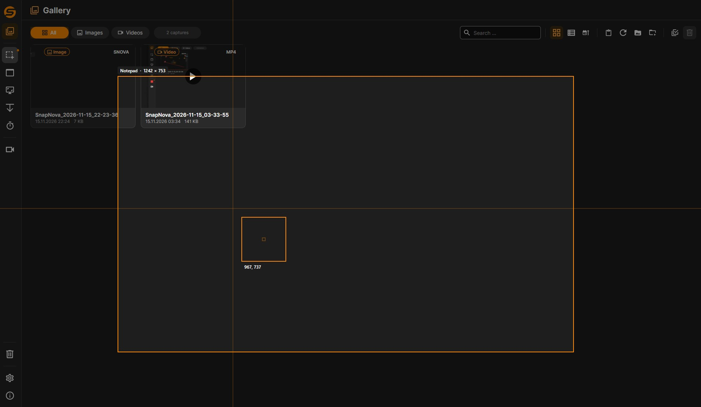

  

# SnapNova

**SnapNova is a screenshot and screen recording app for Windows – open source, offline, no telemetry, no ads.**

SnapNova lives in the **system tray** and is ready in a fraction of a second: press a hotkey or click the tray icon, drag a region or click a window, and the capture opens in the **editor** – arrows, boxes, text, step numbers, highlighter and **Smart Redact** for sensitive data. Every capture lands in the **gallery**, stays editable and can be copied or exported as PNG, JPEG or WebP. **Videos** of a region, a window or the whole screen are recorded with system sound and microphone, hardware-accelerated on NVIDIA, Intel and AMD graphics.

## Features

- **Region, window and full-screen screenshots** – the screen freezes, so menus and tooltips stay in the picture; window snapping, magnifier with pixel coordinates, size display.
- **Scrolling and timer capture** – long web pages and lists in one picture (automatic or manual scrolling), countdown of 3–10 s; hold `Ctrl` while selecting to snap to buttons, panels and list entries.
- **Editor** – arrow, line, rectangle, ellipse, freehand marker and pen, redact, text, numbered steps, crop; every shape stays editable: move, resize, rotate, duplicate; mouse-wheel zoom and panning like in an image editor.
- **Smart Redact and text recognition** – finds e-mail addresses, IPs, IBANs, card numbers, tokens, user names and your own words and blurs them irreversibly; *Copy text* and full-text search work offline with Windows OCR.
- **Nothing is burned in** – captures are saved as `.snova` files: original image plus editable annotations. Copy or export burns them in.
- **Video recording** – region, window or full screen, 15–60 fps, pause/resume, system sound and microphone, cursor highlight and click effects, recording frame and toolbar that never appear in the video.
- **Video editor and player** – plays in a loop; cut with several cut points (e.g. remove the middle), GIF, WebM and *Follow the mouse* zoom.
- **Second recording** – record a second area or monitor at the same time, each with its own colour and, if you like, the sound of its own program.
- **Gallery** – grid or list, sort, display sizes, search (also in recognized text), multi-select, `Ctrl+A/C/V` (paste imports from the clipboard), rename, checkboxes and a delete button, own **recycle bin** page with restore (or the Windows recycle bin).
- **Tray app** – left click: capture picker (or your default capture), right click: full menu; starts with Windows in the tray if you like.
- **Hotkeys** – freely configurable, system-wide; the **Print key** can start any capture.
- **Dark, light or system theme**, smooth animations (can be switched off), English and German. PNG, JPEG or WebP export; MP4 (H.264/HEVC) or MKV video.
- **Offline** – no account, no cloud, no telemetry. Online only with your consent: the FFmpeg download for videos and the optional update check.

## Usage

| Action | How |
| --- | --- |
| Region / window | `Ctrl+Shift+S` – drag a region, click a window, `Enter` for the whole screen, `Esc` cancels |
| Window only | `Ctrl+Shift+W` |
| Full screen (monitor under the mouse) | `Ctrl+Shift+F` |
| Scrolling capture | `Ctrl+Shift+L` – select the scrollable area, `Enter` finishes |
| Timer capture | `Ctrl+Shift+D` |
| Video start / stop | `Ctrl+Shift+R` – select region or window; stop with the same hotkey, the tray icon or *Stop* |
| Pause / resume video | `Ctrl+Shift+P` |
| Print key | region capture (choose another capture in *Settings › Capture*) |
| Capture picker | left click on the tray icon |
| Menu | right click on the tray icon |

In the editor: `V` select · `A` arrow · `L` line · `R` rectangle · `E` ellipse · `H` marker · `P` pen · `B` redact · `T` text · `S` step · `C` crop · `Ctrl+Z`/`Ctrl+Y` undo/redo · `Ctrl+C` copy · `Ctrl+E` export · mouse wheel zooms · Space + drag or the middle mouse button pans · `Ctrl+D` duplicate.

## Video recording and FFmpeg

SnapNova records videos with **FFmpeg**, an independent open-source project. FFmpeg is **not included** in SnapNova. Before the first recording SnapNova shows a license notice; after your consent it downloads the official Windows build from GitHub (about 140 MB), checks its SHA-256 checksum and stores it in your profile. Without internet access (company networks) you can select an existing `ffmpeg.exe` instead. *Settings › Video* shows the status and removes FFmpeg again.

## Requirements

- Windows 10 version 2004 or later, Windows 11, 64-bit. The .NET runtime is included.
- No administrator rights needed to use SnapNova (the system-wide setup asks once).
- Video: any GPU; NVIDIA NVENC, Intel Quick Sync and AMD AMF are used automatically, otherwise Windows Media Foundation.

## Installation

1. Download `snapnova_vX.Y.Z_setup.exe` (or the portable ZIP) from the [releases](https://github.com/complicatiion/SnapNova/releases).
2. The setup installs **for all users** (Program Files) by default; *Install for me only* is the second option.
3. Options in the setup: start with Windows, start in the tray, minimize to the tray, animations, open `.snova` files with SnapNova, *Open with* for images and videos.
4. **Terminal server / multi-session Windows:** install system-wide and tick *Start SnapNova for every user at sign-in* (preselected there) – every user can still switch autostart off in SnapNova.
5. **Keep the tray icon visible:** drag it from the hidden area (^) onto the taskbar.

## Privacy

Everything runs locally. Captures stay in your folders (default `Pictures\SnapNova` and `Videos\SnapNova`), settings in `%LocalAppData%\SnapNova`. Online only for the FFmpeg download you agreed to and – if you switch it on – the daily update check against GitHub. Details: [licenses/PRIVACY.md](licenses/PRIVACY.md).

## Credits

Made with **[Avalonia UI](https://avaloniaui.net/)**, **[SkiaSharp](https://github.com/mono/SkiaSharp)**, **[CommunityToolkit.Mvvm](https://github.com/CommunityToolkit/dotnet)** and **[NAudio](https://github.com/naudio/NAudio)** on **[.NET](https://dotnet.microsoft.com/)**. Videos with **[FFmpeg](https://ffmpeg.org/)** (not bundled; builds by [BtbN](https://github.com/BtbN/FFmpeg-Builds)). Icons: **[Material Design Icons](https://pictogrammers.com/library/mdi/)**, font: **[Inter](https://rsms.me/inter/)**. Licenses: [licenses/README.md](licenses/README.md).

## Project & Copyright

SnapNova is a personal software project by **Sven Klocke** (*sksdesign | complicatiion*).

**Project repository:** [github.com/complicatiion/SnapNova](https://github.com/complicatiion/SnapNova)  
**Website:** [sksdesign.de](https://sksdesign.de)

SnapNova is released under the **MIT License** ([LICENSE.md](LICENSE.md), copy in [licenses/LICENSE.md](licenses/LICENSE.md)). It is provided without warranty – see [licenses/LEGAL-NOTICE.md](licenses/LEGAL-NOTICE.md) and [licenses/COPYRIGHT.md](licenses/COPYRIGHT.md). Third-party components keep their own copyrights and licenses: [licenses/README.md](licenses/README.md).

Windows, FFmpeg, NVIDIA, Intel, AMD, Snagit and all other names are trademarks of their respective owners. SnapNova is not affiliated with or endorsed by them.
